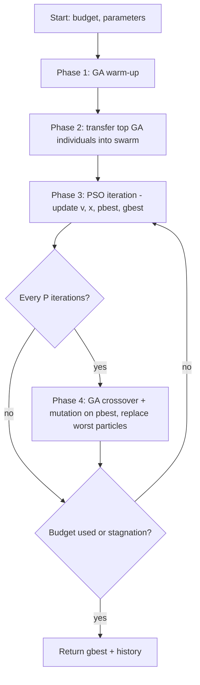

# Algorithm explanation (beginner friendly)

## Genetic Algorithm (`optimization/genetic_algorithm.py`)
A GA imitates evolution. A *chromosome* is one candidate signal plan, e.g. `[38, 19, 28, 25, 21, 35]`
(NS/EW green in three blocks).

1. **Initialise** a population of random plans inside the bounds.
2. **Evaluate** each plan with J (lower = fitter).
3. **Tournament selection**: pick 3 random plans, the one with the lowest J becomes a parent.
4. **Crossover (BLX-alpha)**: each child gene is drawn uniformly from the range between the two parents' genes,
   widened by 30 %. This mixes good plans and can also step slightly outside the parents' range.
5. **Mutation**: each gene is, with probability 0.25, nudged by Gaussian noise (sigma = 10 % of the range).
6. **Elitism**: the 2 best plans are copied unchanged so progress is never lost.
7. Repeat for new generations until the evaluation budget is used.

Strength: explores widely. Weakness: slow at fine-tuning near the optimum.

## Particle Swarm Optimization (`optimization/particle_swarm.py`)
A swarm of particles flies through the search space. Particle *i* has a position `x` (a plan), a velocity `v`, its
own best position `pbest`, and the swarm shares the best position `gbest`.

    v <- w*v + c1*r1*(pbest - x) + c2*r2*(gbest - x)
    x <- x + v

* `w*v` (inertia): keep moving the same way. Decreased from 0.9 to 0.4: explore first, exploit later.
* `c1*r1*(pbest - x)` (cognitive): go back toward the best place I have seen.
* `c2*r2*(gbest - x)` (social): go toward the best place anyone has seen.
* `r1, r2` are random numbers in [0, 1].
* Boundaries: positions are clamped to [10, 60]; the velocity component that hit the wall is set to zero.

Strength: converges quickly. Weakness: the swarm can collapse too early onto a local optimum.

## Hybrid GA-PSO (`optimization/hybrid_ga_pso.py`)
Idea: use each method where it is strong, and let them **exchange information in both directions**.

| Step | What happens | Why |
|---|---|---|
| 1. GA warm-up | ~30 % of the budget is spent evolving a population | wide, global exploration |
| 2. GA -> PSO transfer | the best 50 % of the GA population become particles, the rest are fresh random particles; the transferred fitness values are reused (no extra evaluations) | PSO starts from good *and* diverse positions |
| 3. PSO refinement | normal PSO iterations with pbest / gbest / decaying inertia | fast exploitation |
| 4. PSO -> GA injection | every 5 iterations the personal bests are used as GA parents (tournament, crossover, mutation); the offspring replace the worst 25 % of particles | restores diversity, helps escape stagnation |
| 5. Stop | evaluation budget used up (or no improvement for `patience` iterations) | fairness and efficiency |

It is a genuine hybrid, not a renamed GA or PSO, because both mechanisms run inside one optimisation and exchange
individuals: GA individuals become particles, and particle personal bests become GA parents.
Two switches allow an **ablation**: `warmup_fraction = 0` (no GA warm-up) and `inject_period = 0` (no GA injection).

## Why the comparison uses equal evaluation budgets
Each objective evaluation costs a simulation. An algorithm that is allowed more evaluations will usually find a better
plan, so comparing "50 generations vs 50 iterations" is unfair if they evaluate different numbers of candidates. All
three algorithms therefore get the same number of objective evaluations.

## Flowcharts
See `docs/figures/hybrid_flowchart.png` and `docs/figures/architecture.png` (regenerate with
`python -m visualization.diagrams`). Mermaid version of the hybrid:

